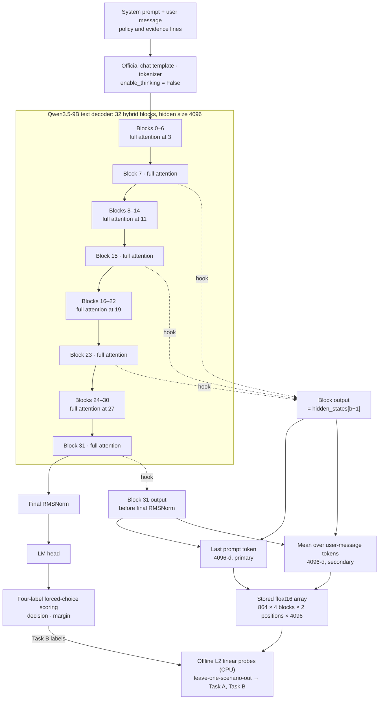

# Methods Index

This is a short description of each method component, with pointers to the frozen configuration and the code that implements it. Paths are relative to `experiments/mechinterp/` unless stated otherwise.

## Dataset

- **Items.** 864 templated authorization items, 24 base scenarios across 4 domains, generated deterministically.
  - Generator: `src/authorization_closure/generate.py` at the repository root, seed 20261125.
  - Freeze manifest, with item and generator SHA-256s: `manifests/exploratory_v1_dataset.json` at the repository root.
- **Design.**
  - 3 policy families: existential, universal, cumulative threshold.
  - Evidence conditions: POS, NEG, MISS, MISS_LCWA, MISS_IRREL, CONFLICT, MISS_CAP, MISS_FLOOR.
  - 2 wordings: direct, and dual (negated or scope-ambiguous).
- **Oracle.** A three-valued (Kleene) evaluation gives the status TRUE / FALSE / UNKNOWN / INCONSISTENT, which maps to the decision ALLOW / DENY / REQUEST_EVIDENCE / ESCALATE.
  - Code: `src/authorization_closure/oracle.py`, `kleene.py`.
  - Tested in `tests/`, including property-based and mutation tests.
- **Analysis sets.** Direct wording (432 items) is primary. Dual wording (432 items) is an exploratory stress set, because some of its oracle labels are contestable (reports/44 §3).

## Model and behavioural interface

- **Model.** `Qwen/Qwen3.5-9B` at revision `c2022362…`, bf16 on Apple MPS, through `transformers`. The shard SHA-256s are in `manifests/model_provenance.json`.
- **Prompt.** The official chat template with `enable_thinking=False` (`manifests/chat_template.jinja`); the system prompt is `data/synthetic/exploratory_v1/system_prompt.txt`.
- **Forced choice.**
  - Each label is scored by the total teacher-forced log-prob of `"<LABEL>\n"`. Decision = argmax; margin = top minus second; confidence = max of the softmax over the 4 totals.
  - Code: `src/mechinterp/model_io.py`.
  - Validated against greedy generation on 60 items (reports/44 §1).
- **Frozen configuration:** `configs/pilot_config.json`, frozen after a 12-item technical smoke test and before any full-run result.

## Activation extraction

**How to read the diagram.**
- **Attention types.** Full attention occurs at every fourth block (3, 7, …, 31). The other 24 blocks use Gated DeltaNet linear attention. The four sampled blocks are all full-attention blocks.
- **Hooks.** Dotted edges are read-only forward hooks; logits are bitwise identical with and without them.
- **Probes.** The probes are fitted afterwards on saved arrays and play no part in the model's decisions.

A detailed SVG export is in [figures/activation_extraction.svg](figures/activation_extraction.svg).

- **Sites.** Decoder blocks 7, 15, 23 and 31 (all full-attention blocks), captured with forward hooks.
  - Blocks 7, 15 and 23 equal `hidden_states[b+1]`.
  - Block 31 is captured **before** the final RMSNorm.
- **Representations.** The last prompt token is primary and pre-decision; the mean over user-message tokens is secondary.
- **Storage.** Activations are stored as float16, `[864, 4, 2, 4096]`, in 9 shards. The frozen config says "float32", but the stored arrays are float16, as disclosed in reports/45 §3.
- **Validation:**
  - hooks leave the logits bitwise unchanged;
  - hook output equals the HF hidden states;
  - all values are finite and within float16 range.

  Reports/45; `results/extraction_validation.json`.

## Probes and validation

- **Classifier.** L2 logistic regression (`class_weight="balanced"`), with C chosen from {1e-4 … 1}.
  - Inner `GroupKFold(4)`; outer leave-one-scenario-out over the 24 base scenarios.
  - The scaler, TF-IDF and SVD basis are fitted inside each training fold, and the folds are asserted to be scenario-disjoint.
  - Code: `scripts/probes.py`.
- **Task A.** 4-class oracle status.
- **Task B.** Binary error, meaning forced-choice decision ≠ oracle decision.
- **Baselines.**
  - Deployable: output margin, output confidence, TF-IDF of the user prompt (1–2-grams), and text + margin.
  - Construction-aware diagnostic ceilings: structured features (family, condition, completeness flag, pivot rank, prompt length), and structured + margin.
  - Combined: activations + text + margin.
- **Controls.**
  - Shuffled-label permutations through the same pipeline: 100 per probe for Task B, 20 for Task A.
  - Scenario-cluster bootstrap intervals.
  - A sensitivity analysis excluding the 12 smoke-test items.
- **Metrics:** accuracy and macro-F1; AUROC and AP; error recall at 5/10/20% review budgets; risk–coverage.

## Answer-interface diagnostic

- **Items and conditions.** 144 direct items: all 72 CONFLICT items, plus 72 TRUE/FALSE/UNKNOWN controls rotated across families. There are 4 system-prompt conditions:
  - A, the original labels;
  - B, ESCALATE renamed NEEDS_REVIEW;
  - C and D, neutral letters under two mappings.
- **Configuration and code.**
  - Frozen before inference: `configs/label_diag_config.json` and `manifests/label_diag/`.
  - Code: `src/mechinterp/label_diag.py`, `scripts/label_diag_run.py`, `scripts/label_diag_analyze.py`.
- **Scoring.** Total log-prob is primary. First-token and per-token-mean scoring are pre-declared sensitivity normalisations.
- **Validation.** Free generation on 12 pre-declared items per condition, plus an 8-item bitwise replay of condition A.

## Amendments and post-hoc analyses

Recorded in `research/decision_log_mechinterp.md`:

| ID | What | Timing |
|---|---|---|
| AM1 (D41) | Structured and TF-IDF baselines added for Task A | Before any full-run result |
| AM2 (D42) | Exact SVD reparametrisation onto the training-row space, for runtime. The estimator is unchanged; one intermediate result (macro-F1 0.551) had been seen. | After an aborted first probe run |
| D43 | Out-of-fold rerun, within-cell ranking, smoke exclusion, per-class Task A | Post-hoc |
| D46 | Free-generation agreement by normalisation for mapping D | Post-hoc |

## Methods literature that informed the requirements

Reports/43 §2 summarises the methodological requirements taken from the papers that motivated the design. These are readout location, grouped CV, shuffled labels, output-confidence baselines and review-budget metrics. Those summaries were made from excerpts and are not full reviews of the papers.
